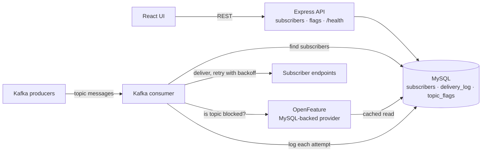

# webhooks-sample-app

A worked example of what a codebase looks like after Telem BDD has been applied to it. It is meant to be read, not run: it ships without the Telem libraries, so treat it as a static codebase to browse.

Note that this sample was manually sanitized from references to Forter's internal libraries, which means the tests can not be executed.

## How it was made

**All of the code, production and test alike, was written by AI agents, with humans steering.** People set goals, made the design calls, approved each phase gate and rejected wrong turns. Agents wrote every line, using the Telem BDD skills for Claude Code.

The git history records that process in order:
1. The app itself was written.
2. Following Telem's skills, agents bootstrapped a test harness, built fakes for every IO boundary, and identified the feature flags.
3. Four business flows were backfilled with tests, one at a time.

## The app

A small webhooks delivery platform. It has several distinct IO boundaries on purpose, because they give the tests something real to exercise:

- **HTTP in**: a REST API for managing subscribers and flags, plus a `/health` probe.
- **Kafka in**: a consumer receives messages per topic.
- **MySQL**: subscribers, a delivery log, and per-topic flags.
- **HTTP out**: each message fans out to subscriber endpoints, with exponential-backoff retry.
- **OpenFeature**: a per-topic "delivery blocked" flag, served by a MySQL-backed provider.

A React UI, served by the same Express app, is a client of the REST API. It isn't under test.



## Where to look

```
src/                      production code (Express API, Kafka consumer, delivery, flags, MySQL repositories)
client/                   React UI
test/telem/
  features/<flow>/        one directory per business flow:
    <flow>.feature          the scenarios: start here
    <flow>.analysis.md      how the flow works: pipeline, IO dependencies, call graph
    <flow>.implementation-notes.md   coverage accounting, pinned bugs, deferred items
  step-definitions/       step code; one file per flow plus shared steps
  support/
    world.ts              loads the app with every IO boundary swapped for its fake
    fakes/                one fake per boundary (MySQL, fetch, Kafka, OpenFeature, clocks and UUIDs)
    fakes/parity-tests/   the same cases run against each fake and the real service
CONTRIBUTING.md           the gated red-green-refactor-whitebox workflow a team would follow
```

The flows are subscriber management, flag management (including the flag provider), webhook delivery, and the health check. `webhook-delivery.feature` is the richest of the four. `flag-provider.feature` shows how app code that sits behind a faked SDK is still put under test.
