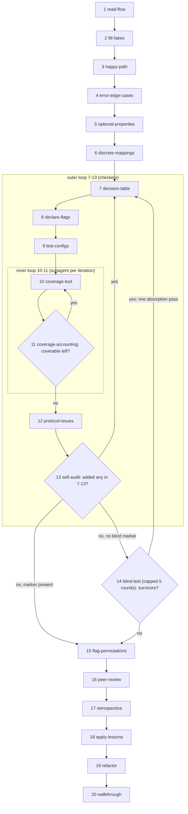

# `/telem-{platform}:backfill`

The backfill skill is a complex, long-running orchestrator skill that invokes sub-skills that execute the work. In this guide, the skill `/telem-{platform}:{skill-name}` will be abbreviated to `/{skill-name}`. Note that no sub-skill should ever be invocable outside this scope.

When building out this skill and the skills herein, build them as terse as possible, and make sure that they are forward-linked only (if the orchestrator doesn't invoke them directly, the previous skill has to invoke the next one, while the next one should not be aware of the caller).

## Phases

`/backfill` is a skill that will run once for each business flow. The first run does a lot of heavy lifting to bootstrap everything. At the beginning of each run, it runs `/preflight`. At the end of each run, it advances `.telem/bdd-onboarding-progress.json`.
Every phase, step, skill, etc. *must* at least review its own work before proceeding. Order of preference: Deterministic tool (linter, etc.) >> non-deterministic (sub-agent review) >> user review.

### Each run starts with `/preflight`

All deterministic preflight checks that will let us fail-fast. Some examples:
1. Runtime version meets the repo’s floor.
2. Tools, external skills, external services, and MCP connections required by any Telem skill are available and active.
3. The right type of model is in use.
4. The suite is green and the working tree is clean.
5. The skills plugins and dependencies are up to date. See [Plugin Versioning](../plugin-versioning.md) for more info about versions.

### `/bootstrap`

Initial phase. The default when no phase tracking in `.telem/bdd-onboarding-progress.json` is available. Sets up the repository for backfilling.

1. Explores the repo, creating a bootstrap report (entry points, IO boundaries, non-determinism, flags).
2. Installs all required runtime deps (Cucumber/coverage/telem tools).
3. Makes the smallest possible production change so the tests have an entry point.
4. Writes the Cucumber config and the BDD directory layout.
5. Builds the fakes registry.
6. Builds the Cucumber World class, including:
   1. How fakes replace the repo's module system (e.g. in Node, require-cache seeding / esm / esmock).
   2. For isolation, each scenario getting a unique identifier at runtime and that propagating to the fakes.
   3. Disallowing all incoming/outgoing network connections while the tests run. For hints on how to do this, go to [network block](../hints/network-block.md).
7. Creates the run targets (npm scripts, make targets, etc.) that run the tests and generate coverage reports.
8. Proves everything works with zero tests, then with a single smoke test, which is then deleted.

### `/create-fakes`

Create the basic skeleton for fakes for already-discovered IO.

1. Reads the IO inventory created in `/bootstrap`.
2. Builds the fakes themselves, including their parity tests. For more information about the fakes and parity tests, read [Fakes](../fakes.md).
3. Wires the fakes in the World, tests that everything works, including seeding.
4. Fakes all other sources of non-determinism, like clocks, random, and UUIDs. Wire those into the World and test.
5. Seeds initial reference data, if needed.
6. Creates the default steps file under `tests/telem/features/defaults.{ext}` (see [Runtime Artifacts](../runtime-artifacts.md)) and adds the [`"No unowned IO changes should remain"` rule](../fakes.md).
7. Writes `WRITING-FAKES.md`.
8. Writes temporary meta-tests to see that unowned IO does fail and a real outbound network call is blocked.

### `/identify-feature-flags`

Understand how to find feature flags and how to wire them into the tests.

1. Finds every flag access pattern and builds a strict flag fake that throws on any undeclared read (declarations are in `tests/telem/flag-manifest.json`). Hook the fake the same way previous fakes were hooked up. Note that in this step you may have already faked this specific input, so that must be replaced.
2. Adds reusable Given steps for flags (setting / unsetting a flag).
3. Puts baseline flags in `tests/telem/features/defaults.{ext}`. Prefer what currently exists in Production as the baseline.
4. Writes the stub `tests/telem/flag-manifest.json`.

### `/backfill-tests`

#### Before `FLOW-CHECKLIST.md` exists

On the first run it discovers user-observable business flows: it reads `BOOTSTRAP-REPORT.md`, then searches routes, consumers and crons beyond it. The user multi-selects which technical patterns count. Flows get business names and complexity ratings and land in `FLOW-CHECKLIST.md`, which is `crit`-reviewed (large flows get split-candidate notes).

Some single flows have a scenario space too large to backfill in one pass without overflowing the context the agent and the human must hold. A split lifts one or more behavior-defining axes, either a set of combinable toggles (every subset, including none) or a mutually-exclusive choice, out of the flow and up to the flow checklist, turning the flow into a cross-product of sub-flows that are each backfilled on their own. It is proposed only when the projected space is large and an axis's values genuinely diverge, and the user can declare one at any time. Every combination is generated, and one leaves the set only by an explicit, per-combination exclusion backed by reading the code, never a bulk rule, because each exclusion is a business claim a human must own. Large axes are first grouped into behavior families. Each combination ends as its own feature file when its structure diverges, as extra example rows in an existing file when only values change (asserting the output an interaction would change, or the rows guard nothing), or as excluded. A human reviews the short declaration rather than the expanded rows, and a deterministic check ([audit-flow-split](../tools/audit-flow-split.md)) proves the expansion is complete and every combination is resolved. Coverage is measured per sub-flow (scoped by the sub-flow's own feature files; the report itself is never filtered, so shared code is still seen) to keep discovery bounded, with a whole-suite sweep as the backstop for gaps that fall between combinations.

#### Once `FLOW-CHECKLIST.md` exists

Every run starts by offering a flow from the checklist. When the user picks the flow, it begins the flow backfill process with no pauses, after which it checks the flow in the checklist.

The backfill now has the following steps as skills, where each will invoke the next one. This order, the loops, etc. will be open for specialization and interpretation once the user has had time to work with Telem for a bit. For now, this is the baseline:

1. `/read-flow`: Best-effort tracing of the flow along all possible axes: handler pipeline, call graph into sub-modules, service boundaries, etc. Then a codebase-wide domain grep for dynamically loaded code, plus a grep of `COLLECTED-WISDOM.md`. Outputs: a date-stamped `<flow>.analysis.md` listing IO dependencies, config dimensions, and missing fakes. Can propose a flow split.
2. `/fill-fakes`: Makes every IO dependency in the analysis faked and wired, if it isn't already. Builds missing fakes via the same skills used in `/create-fakes`. Notes that pre-existing fakes may have partial implementation, so fills in the blanks. Re-runs parity for new/changed fakes.
3. `/happy-path`: Creates `<flow>.feature` with a minimal Background and the primary valid-input scenario, asserting the full response and every IO side effect via `takeOwnershipOf*`. Adds only variations that are observably different. Puts the flow's always-present IO into `defaults.{ext}` as separately opt-outable entries. Runs the suite and `gplint`, registering bracketed IO names in `.gplintrc`.
4. `/error-edge-cases`: Works the failure-mode catalog against every branch of the pipeline, injecting each failure per operation with `fail(scenarioId, op, [err])`. See [Discovery: Error taxonomy](../discovery.md#3-error-taxonomy).
5. `/optional-properties`: Inventories optional input fields and adds scenarios for them. See [Discovery: Optional properties](../discovery.md#6-optional-properties).
6. `/discrete-mappings`: Finds every switch/if-chain/lookup/filter/transform keyed on external input and covers each. See [Discovery: Discrete mappings](../discovery.md#7-discrete-mappings).
7. `/decision-table` **(outer-loop entry)**: Re-derives behavioral dimensions from every scenario plus the endpoint's observable surface (including framework 400/413/404/405), crosses them into a gitignored TSV, and triages each cell: `cannot-occur` / `new` (full scenario) / `belt` (compact Outline over a code path confirmed shared) / `covered`. `covered` and `belt` reasons quote the scenario title. Gate: `telem-bdd check-decision-table --feature` clean, plus advisory reason-quality llm-lint.
8. `/declare-flags`: Runs the suite and collects strict-flag "not declared" failures. Classifies each flag into baseline / manifest / Given step, each with a comment saying what it does. See [Discovery: Feature flags](../discovery.md#9-feature-flags).
9. `/test-configs`: Covers every configuration value that changes observable output, and adds After-hook cleanup for per-scenario seeds. See [Discovery: Config dimensions and fixtures](../discovery.md#8-config-dimensions-and-fixtures).
10. `/coverage-tool` **(inner-loop entry)**: Each iteration runs in its own subagent: coverage over the flow's features (single-process, report unfiltered), read uncovered branches, sweep every loaded file, write scenarios that assert behavior (not just status) for coverable ones, document the rest.
11. `/coverage-accounting` **(inner-loop exit)**: Reviews every file in the report and classifies each uncovered branch **and** statement: coverable (scenario/TODO) / unreachable-from-this-flow (grouped by root cause) / instrumentation artifact / telemetry-only. See [Discovery: Reachability](../discovery.md#2-reachability). Code proven dead by an unconditional throw is filed as a bug. Writes it all to `<feature>.implementation-notes.md` and logs prod bugs separately. Loops to 10 while coverable branches remain.
12. `/protocol-issues`: For each external system: protocol thinking (what can happen on the wire between the two systems) plus code-path thinking (which branches exist). Tests outbound shape and inbound handling. Negative-asserts silent drops. No two protocol outcomes that are indistinguishable at every observable boundary get separate scenarios (see [Discovery: Protocol thinking and code-path thinking](../discovery.md#5-protocol-thinking-and-code-path-thinking)).
13. `/self-audit` **(outer-loop exit)**: Re-reads the flow, every scenario against the standards, and every faked module's production source against its fake. Checks that no step was skipped, loops until a full pass finds nothing, and queues an "ask the user what I missed" Task. Routing: any scenario added in 7–13 → back to 7. Zero added and no `Blind test (Step 14): complete` marker in the per-flow notes → 14. Marker present → continue.
14. `/blind-test`: Outside the loop, once per flow. A fresh subagent sees only the feature file and guesses scenarios blind, then may read source to fix them. Survivors are merged, reworded onto existing steps, and deduped. Capped loop: stops at a round with 0 survivors or after 5 rounds. Writes the marker. Survivors → one absorption pass from 7. None → continue.
15. `/flag-permutations`: Categorizes the flow's flags per [Discovery: Feature flags](../discovery.md#9-feature-flags) and records them in `flag-manifest.json` (the feature must appear even with zero flags). Runs the [flag permutation runner](../tools/flag-permutation-runner.md), then the full suite.
16. `/peer-review`: Spin up a sub-agent with a multi-persona review with 5 personas over all changed files. One of the personas represents the methodology. Triage: must-fix / should-fix (apply now) / won't-fix (with rationale) / refactor-class (queued in implementation-notes for the last step). A confirmed llm-lint violation is always must-fix. The discussion is not committed.
17. `/retrospective`: Writes debugging-cost lessons to files. Lessons that are new, generalizable and were costly go to `WRITING-TESTS.md`. Repo-specific gotchas go to `COLLECTED-WISDOM.md`, which never holds process rules. Points where the user intervened come first. Checks consistency and that no lesson was lost.
18. `/apply-lessons`: Applies lessons learned from this run to previous feature files. Diffs the new `WRITING-TESTS.md` changes and runs one parallel subagent per (change × feature file), covering **all** features. Consolidates the duplicate step definitions this creates, then reruns the suite and permutations.
19. `/refactor`: Dedups step definitions/helpers/seeds, collapses parameterizable scenarios into Outlines, and extracts Background/shared steps. Uses a subagent. Scenario count must stay stable and no step ambiguity may be introduced. Hands back to the orchestrator; doesn't mark the flow `[x]`.
20. `/walkthrough`: Explains the feature file to the user using only the file itself, most abstract level first, one HTML page per level reviewed in `crit`. Each correction is diagnosed: (a) I misread / (b) unclear wording → fix the wording / (c) real bug → report it, don't fix / (d) a wrong assessment → re-grade / (e) untested behavior → write the scenario, and if it's more than a local fix, back to the outer-loop.

After every backfill of a business flow, idempotently add the Telem test suite to build / CI so it's run on every build, even outside the developer's own machine.

### `/verify-full-coverage`

Once all tests are backfilled, explore what code still isn't covered by tests and why.

Runs a whole-suite, unfiltered coverage sweep over every file (never-loaded ones included) plus every deferred TODO. Each gap becomes new flow / dead code / coverable (gets a scenario) / unreachable / artifact / telemetry. Loops until a pass adds 0 scenarios and 0 flows with gates green.

Queuing a new flow adds it to `FLOW-CHECKLIST.md` and back to backfill-tests.

### `/graduate`

Graduates the repository to start using red-green-refactor-whitebox:

1. Salvages durable knowledge from the work product artifacts.
2. Compacts and keeps the per-flow notes, preserving the date stamp.
3. Sets up `CONTRIBUTING.md` and the contribute workflow (see [Red-Green-Refactor-Whitebox](../red-green-refactor-whitebox.md))
4. Stages deletion of the rest of the work product markdown files like `BOOTSTRAP-REPORT.md` and `FLOW-CHECKLIST.md`.
5. Marks `.telem/bdd-onboarding-progress.json` as complete.
6. Writes an initial `.telem/bdd-freshness.json`.
